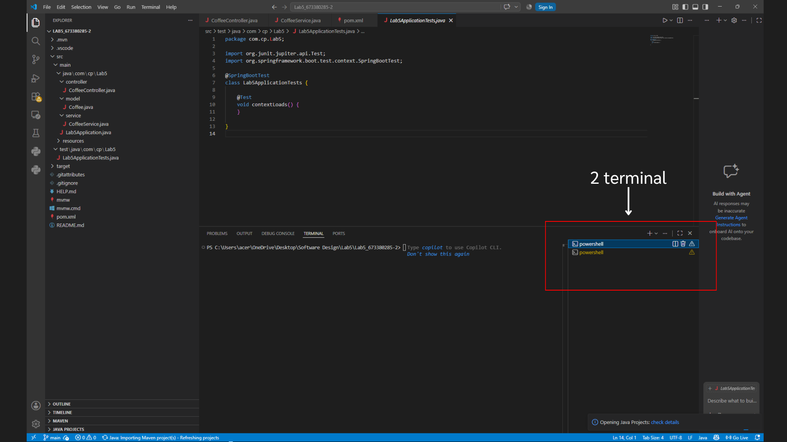
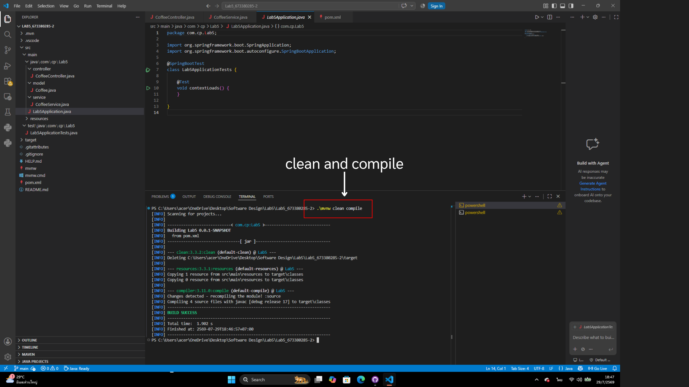
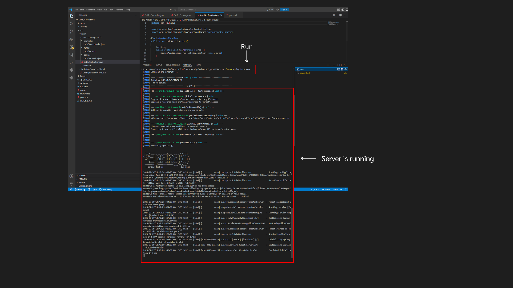
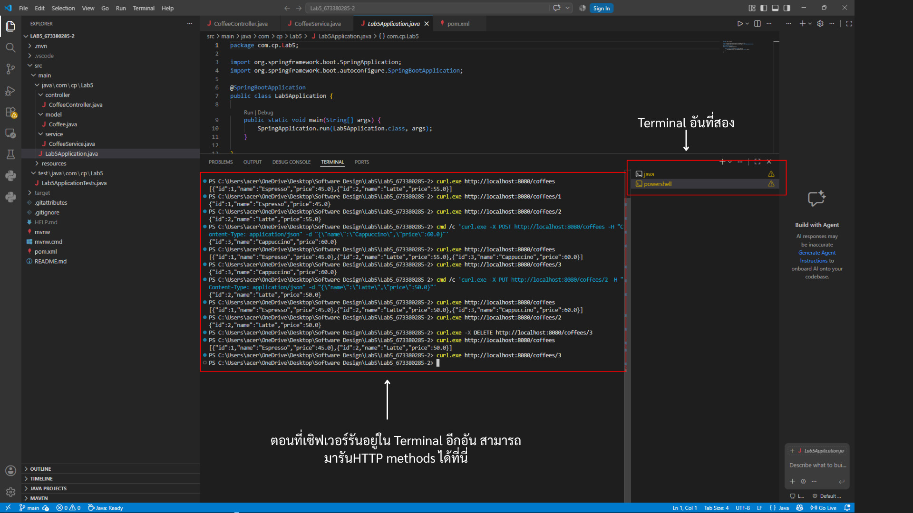
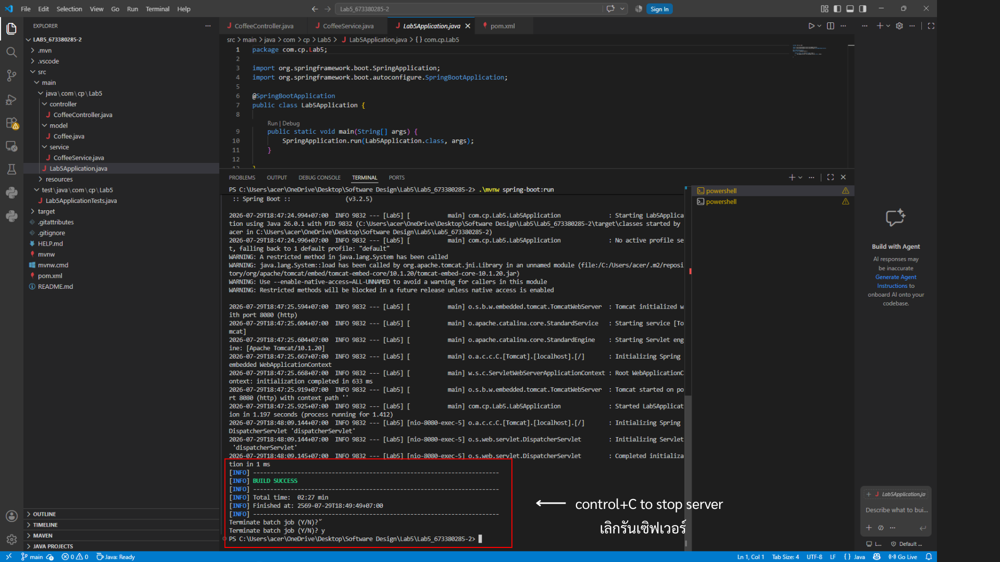

# Lab5_673380285-2


## 🚀 วิธีรันโปรเจกต์ (How to Run)

โปรเจกต์นี้รันผ่าน **VS Code** โดยใช้ **2 Terminal พร้อมกัน** — Terminal แรกสำหรับรันเซิร์ฟเวอร์ Spring Boot ให้ทำงานค้างไว้ ส่วน Terminal ที่สองใช้สำหรับยิงคำสั่งทดสอบ HTTP methods (GET/POST/PUT/DELETE) ระหว่างที่เซิร์ฟเวอร์กำลังทำงานอยู่

### สิ่งที่ต้องมีก่อนเริ่ม (Prerequisites)

| สิ่งที่ต้องมี | เวอร์ชัน |
| --- | --- |
| Java (JDK) | 17+ |
| Maven | ติดตั้งแล้ว หรือใช้ `mvnw` ที่แนบมากับโปรเจกต์ |
| VS Code | พร้อม Extension: Java, Spring Boot |

---

### ขั้นตอนที่ 1 — เปิด 2 Terminal ใน VS Code

[#เปิด-2-terminal]

เปิด Terminal ใน VS Code แล้วกดปุ่ม **Split Terminal** (หรือ `Ctrl + Shift + 5`) เพื่อแบ่งเป็น 2 หน้าต่างในพื้นที่เดียวกัน:

- **Terminal 1** → ใช้สำหรับ Build และรันเซิร์ฟเวอร์ (ปล่อยให้ทำงานค้างไว้ตลอด)
- **Terminal 2** → ใช้สำหรับยิงคำสั่งทดสอบ API ด้วย `curl`


*ภาพที่ 1: แบ่งหน้าต่าง Terminal เป็น 2 อันใน VS Code*

> 💡 เหตุผลที่ต้องใช้ 2 Terminal: เพราะ `mvn spring-boot:run` เป็นคำสั่งที่ **ค้าง (blocking)** เซิร์ฟเวอร์จะรันอยู่ใน foreground ตลอดเวลา ทำให้ Terminal นั้นพิมพ์คำสั่งอื่นไม่ได้ จึงต้องมี Terminal อีกอันแยกไว้ยิง request

---

### ขั้นตอนที่ 2 — Clean และ Compile โปรเจกต์ (Terminal 1)

[#clean-and-compile]

ก่อนรันเซิร์ฟเวอร์ ให้เคลียร์ของเก่าและคอมไพล์โค้ดใหม่ก่อน เพื่อลดปัญหา cache หรือ class ค้าง:

```bash
mvn clean compile
```


*ภาพที่ 2: ผลลัพธ์การ Clean และ Compile โปรเจกต์*

✅ หากขึ้น `BUILD SUCCESS` แปลว่าโค้ดไม่มี error และพร้อมรัน

---

### ขั้นตอนที่ 3 — รันเซิร์ฟเวอร์ (Terminal 1)

[#run-server]

```bash
mvn spring-boot:run
```

เมื่อรันสำเร็จ จะเห็น log ของ Spring Boot (โลโก้ ASCII) และข้อความประมาณนี้ว่าเซิร์ฟเวอร์เริ่มทำงานแล้วที่พอร์ต **8080**:


*ภาพที่ 3: เซิร์ฟเวอร์ Spring Boot กำลังทำงานอยู่ที่ Terminal 1*

⚠️ **สำคัญ:** ปล่อย Terminal 1 นี้ทำงานค้างไว้แบบนี้ตลอด **ห้ามกดปิดหรือพิมพ์คำสั่งอื่นทับ** ไม่เช่นนั้นเซิร์ฟเวอร์จะหยุดทำงานทันที

---

### ขั้นตอนที่ 4 — ทดสอบ API (Terminal 2)

[#test-api](#test-api)

ระหว่างที่ Terminal 1 รันเซิร์ฟเวอร์อยู่ ให้สลับไปที่ **Terminal 2** เพื่อยิงคำสั่งทดสอบทีละ endpoint:

```bash
# GET ทั้งหมด
curl http://localhost:8080/coffees

# GET ตาม id
curl http://localhost:8080/coffees/1

# POST เพิ่มเมนูใหม่
curl -X POST http://localhost:8080/coffees `
     -H "Content-Type: application/json" `
     -d '{\"name\":\"Cappuccino\",\"price\":60.0}'

# PUT แก้ไขเมนู
curl -X PUT http://localhost:8080/coffees/2 `
     -H "Content-Type: application/json" `
     -d '{\"name\":\"Latte\",\"price\":50.0}'

# DELETE ลบเมนู
curl -X DELETE http://localhost:8080/coffees/3
```


*ภาพที่ 4: ผลการทดสอบ HTTP methods ทั้งหมดที่ Terminal 2 ขณะเซิร์ฟเวอร์ยังรันอยู่*

> 💡 บน **PowerShell (Windows)** ต้อง escape เครื่องหมาย `"` ด้วย `\"` และใช้ backtick `` ` `` ต่อบรรทัด (ตามตัวอย่างด้านบน) ไม่เช่นนั้นจะเจอ error แบบ `unmatched close brace/bracket`

✅ ทุก request ควรได้ผลลัพธ์เป็น JSON กลับมาตรงตาม [Expected Result](#4-expected-result-ผลลัพธ์ที่ต้องได้) ของโจทย์

---

### ขั้นตอนที่ 5 — หยุดเซิร์ฟเวอร์

[#stop-server](#stop-server)

เมื่อทดสอบเสร็จแล้ว กลับไปที่ **Terminal 1** (Terminal ที่รันเซิร์ฟเวอร์อยู่) แล้วกด:


*ภาพที่ 5: หยุดการทำงานของเซิร์ฟเวอร์ด้วย Ctrl+C ที่ Terminal 1*

เซิร์ฟเวอร์จะหยุดทำงาน และ **ข้อมูลทั้งหมดใน List (in-memory) จะหายไปทันที** เนื่องจากไม่มีการเชื่อมต่อฐานข้อมูล — หากรันใหม่อีกครั้งข้อมูลจะกลับไปเป็นค่าเริ่มต้น (Espresso, Latte) เหมือนตอนแรก

---

### สรุปขั้นตอนแบบย่อ

[#สรุป](#สรุป)

| ลำดับ | Terminal | คำสั่ง | ผลลัพธ์ | รูปประกอบ |
| --- | --- | --- | --- | --- |
| 1 | Terminal 1 & 2 | เปิด Split Terminal | ได้ 2 หน้าต่าง Terminal | springboot_run_image/1.png |
| 2 | Terminal 1 | `mvn clean compile` | Build โค้ดให้พร้อมรัน | springboot_run_image/2.png |
| 3 | Terminal 1 | `mvn spring-boot:run` | เซิร์ฟเวอร์เริ่มทำงานที่ port 8080 | springboot_run_image/3.png |
| 4 | Terminal 2 | `curl ...` | ทดสอบ GET / POST / PUT / DELETE | springboot_run_image/4.png |
| 5 | Terminal 1 | `Ctrl + C` | หยุดเซิร์ฟเวอร์ | springboot_run_image/5.png |